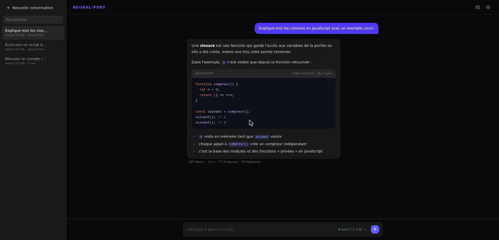

<div align="center">

# Neural-Port

**Une interface de chat soignée pour vos modèles [Ollama](https://ollama.com). Tout reste sur votre machine.**

[](https://github.com/edouardbautz/Neural-Port/actions/workflows/ci.yml)
[](LICENSE)
[](https://nodejs.org)



</div>

## Pourquoi Neural-Port

Faire tourner un modèle en local, c'est la garantie que vos conversations ne quittent pas votre machine. Neural-Port y ajoute le confort qu'on attend d'un assistant moderne : historique, Markdown, fichiers générés, thème sombre, et une gestion de la mémoire du modèle qui évite qu'une longue conversation ne s'effondre.

- **Local et privé** : aucun compte, aucune télémétrie, aucun service tiers. Les conversations sont stockées dans votre navigateur.
- **Léger** : une application web statique, sans serveur à part Ollama.
- **Robuste** : Ollama éteint, modèle absent, stockage plein, historique abîmé… chaque cas est géré et expliqué à l'écran.

## Fonctionnalités

| | |
|---|---|
| **Conversations** | Historique dans une barre latérale, nommage automatique, renommage (double-clic), recherche dans les titres et les messages. |
| **Streaming** | Le texte s'affiche au fil de la génération ; arrêt à tout moment (`Échap`). Statut précis : chargement du modèle, traitement du contexte, réflexion. |
| **Modèles** | Tous vos modèles Ollama dans un menu, rechargé à chaque ouverture. Les modèles de raisonnement (DeepSeek-R1, QwQ, GPT-OSS…) affichent leur réflexion dans un bloc repliable. |
| **Markdown** | Tableaux, listes, citations, code avec coloration syntaxique (thèmes clair et sombre), copie en un clic. |
| **Fichiers générés** | Demandez « écris-moi `jeu.py` » : le fichier apparaît dans un panneau avec aperçu et téléchargement. Un bloc de code devient un fichier d'un clic. |
| **Fenêtre de contexte** | Taille réglable avec une jauge d'utilisation et le niveau de réflexion (Off / Low / Medium / High). |
| **Compaction automatique** | Quand la conversation approche de la limite du contexte, les anciens messages sont résumés par le modèle ; vos messages d'origine restent affichés et conservés. |
| **Édition** | Modifier un message, régénérer une réponse. |
| **Sauvegarde** | Export et import JSON de vos conversations ; un historique partiellement corrompu est réparé plutôt que rejeté. |
| **Connexion** | Bannière explicative et reconnexion automatique si Ollama ne répond pas ; adresse du serveur réglable. |

**Raccourcis** : `Ctrl+K` nouvelle conversation · `Ctrl+,` paramètres · `Échap` arrêter la génération · `Entrée` envoyer (`Maj+Entrée` pour un retour à la ligne).

## Démarrage rapide

**Prérequis** : [Node.js](https://nodejs.org) 20.19 ou plus, et [Ollama](https://ollama.com) lancé avec au moins un modèle.

```bash
ollama pull llama3.2:3b      # si vous n'avez encore aucun modèle

git clone https://github.com/edouardbautz/Neural-Port.git
cd Neural-Port
npm install
npm run dev
```

Ouvrez <http://localhost:5173>.

Pour un déploiement statique, `npm run build` produit le dossier `dist/`, à servir avec n'importe quel serveur web (`npm run preview` pour l'essayer).

## Configuration

### Ollama sur une autre adresse

Par défaut, Neural-Port contacte `http://localhost:11434`. L'adresse se règle dans **Paramètres → Adresse d'Ollama**.

Si vous ouvrez l'application depuis une autre adresse (réseau local, Docker, autre machine), ou si Ollama refuse la connexion (erreur CORS), autorisez l'origine de l'application au démarrage d'Ollama :

```bash
OLLAMA_ORIGINS="http://localhost:5173" ollama serve
```

Remplacez l'origine par l'adresse réelle de l'application (ou `*` pour tout autoriser, à éviter hors de votre réseau). Si Ollama tourne sur une autre machine, ajoutez `OLLAMA_HOST=0.0.0.0` puis saisissez son adresse dans les Paramètres.

> [!WARNING]
> Ollama n'a pas d'authentification : ne l'exposez pas sur Internet. Une application servie en `https://` ne peut pas joindre un Ollama en `http://` (blocage du navigateur).

### Vos données

Les conversations sont conservées dans l'**IndexedDB** de votre navigateur (pas de plafond de 5 Mo, et seules les conversations modifiées sont réécrites), les réglages dans son `localStorage`. Rien n'est chiffré : sur une machine partagée, utilisez un profil dédié. Les conversations d'une version antérieure (stockées dans `localStorage`) sont migrées automatiquement au premier lancement.

Utilisez **Paramètres → Données** pour exporter vos conversations, les sauvegarder ou les transférer vers un autre navigateur. Si le stockage du navigateur est plein ou refusé, un bandeau vous prévient pour que vous puissiez exporter avant de perdre quoi que ce soit.

## Développement

```bash
npm run dev       # serveur de développement (Vite)
npm run lint      # ESLint
npm test          # tests unitaires (Vitest)
npm run build     # vérification TypeScript + build de production
```

Stack : React 19, TypeScript, Vite, Tailwind CSS 4, react-markdown, Vitest. Le rendu Markdown et la coloration syntaxique sont chargés à part, pour un premier affichage rapide.

```
src/
├── App.tsx            assemblage de l'interface et orchestration d'une réponse
├── components/        interface (messages, barre latérale, paramètres, fichiers…)
├── hooks/             état persistant et connexion à Ollama (useHistory, useOllamaConnection)
└── lib/               logique pure et testée (flux Ollama, compaction, fichiers, historique, Markdown…)
```

## Contribuer

Les contributions sont les bienvenues ! Lisez [CONTRIBUTING.md](CONTRIBUTING.md) pour la mise en route, les conventions et la liste de vérification des pull requests. Pour signaler une faille, voir [SECURITY.md](SECURITY.md). Le projet suit un [code de conduite](CODE_OF_CONDUCT.md).

L'historique des versions est dans le [CHANGELOG](CHANGELOG.md).

## Licence

Distribué sous [licence MIT](LICENSE). Copyright © 2026 MeteoreLeVrai.
